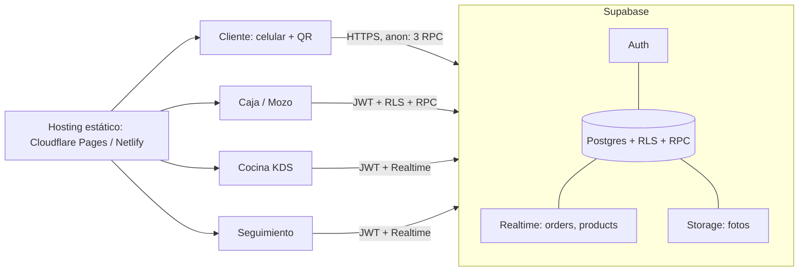
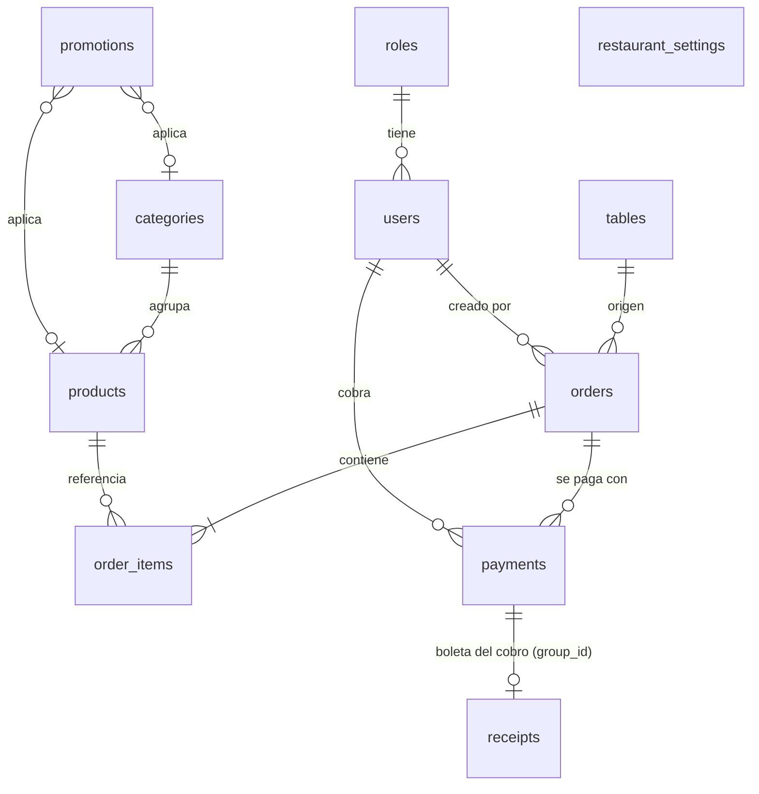

# Arquitectura — RestoPOS (Fase 1)

## 1. Requisitos cubiertos
POS/Caja · carta digital · QR por mesa · cocina (KDS) · seguimiento · pagos · reportes · usuarios/roles · tiempo real · costo cero dentro de los límites de los planes gratuitos (ver `LIMITES_PLAN_GRATUITO.md`).

## 2. Arquitectura general

Todas las pantallas son la **misma SPA** (React) servida como archivos estáticos. Todas leen y escriben en **una sola base de datos**, por eso están siempre sincronizadas.

### Decisión: sin backend propio en Node
- Las reglas críticas (precios, estados, duplicados, permisos) viven en **funciones SQL `SECURITY DEFINER`** y en **RLS**, junto a los datos: una sola fuente de verdad y transacciones atómicas.
- Menos piezas = menos fallos y **cero costo de servidor** (los hosts gratuitos de Node duermen el proceso y añaden latencia).
- Node se usa solo para compilar (Vite) y scripts de administración (`create-staff`, `backup`).
- Costo de la decisión: la lógica está en SQL (más difícil de depurar para quien no lo domina) y está atada a PostgreSQL. Se mitiga con 150 pruebas automatizadas.

## 3. Modelo de datos (ER)

Tablas: `users, roles, tables, categories, products, orders, order_items, payments, restaurant_settings` (las 9 pedidas) + `promotions` (necesaria para "promociones" de la carta) + `receipts` (migración 2: datos de la boleta y serie-número emitida en SUNAT; ver `BOLETAS_SUNAT.md`). PK/FK/índices/CHECK están en `supabase/migrations/20260101000000_init_schema.sql`.

## 4. Roles y permisos
| Permiso | admin | cashier | waiter | kitchen |
|---|:-:|:-:|:-:|:-:|
| orders.view | ✓ | ✓ | ✓ | ✓ |
| orders.create / orders.edit | ✓ | ✓ | ✓ | |
| orders.cancel | ✓ | ✓ | | |
| orders.kitchen (preparando/listo) | ✓ | | | ✓ |
| orders.serve (entregado) | ✓ | ✓ | ✓ | |
| payments.register (cobrar, ticket y boleta) | ✓ | ✓ | | |
| reports.view | ✓ | ✓ | | |
| menu.manage, tables.manage, users.manage, settings.manage | ✓ | | | |

El cliente QR es **anónimo** y solo puede ejecutar 3 funciones: ver la mesa, ver sus pedidos y crear un pedido.

## 5. Flujo de un pedido
```mermaid
sequenceDiagram
  participant Cli as Cliente QR
  participant DB as Postgres (RPC)
  participant Coc as Cocina
  Cli->>DB: create_qr_order(token, items[product_id,qty,nota], request_id)
  DB->>DB: valida token, mesa activa, productos disponibles, tope de pendientes
  DB->>DB: calcula precios y total EN EL SERVIDOR; idempotencia por request_id
  DB-->>Cli: número de pedido
  DB-->>Coc: evento Realtime (orders)
  Coc->>DB: set_order_status(preparing → ready)
  Caja->>DB: set_order_status(delivered) · register_payment
```
Estados: `pending → preparing → ready → delivered` (más `cancelled`). Las transiciones válidas y el permiso necesario se validan en `set_order_status`.

## 6. Sincronización en tiempo real (Fase 4)
**Tecnología: Supabase Realtime (Postgres Changes)**, incluida en el plan Free.
- Se publican solo `orders` y `products` (los ítems no, para ahorrar mensajes); la pantalla recarga el pedido completo ante cada evento (agrupado en 150 ms).
- Respaldo: se recarga al reconectar, cada 20 s (sondeo) y al volver a la pestaña/en línea.
- Los clientes QR **no** abren conexiones Realtime (el límite Free es 200 simultáneas): consultan su estado cada 15 s.
- Alternativas descartadas: Firebase (prohibido por requisito); WebSockets propios (exigen servidor Node siempre activo, lo que contradice el costo cero); sondeo puro (más tráfico y latencia).

## 7. Problemas previstos y solución
| Problema | Solución |
|---|---|
| Doble envío / doble clic / reintento por mala señal | `client_request_id` único (idempotencia) + condición de carrera controlada |
| Cliente manipula precios | El cliente envía solo `product_id`, cantidad y nota; el servidor calcula todo |
| Producto agotado tras llenar el carrito | Se valida al confirmar; error claro al cliente |
| Spam desde el QR | Máximo de pedidos pendientes por mesa (`qr_max_pending_per_table`) |
| QR adivinable | Token aleatorio de 20 caracteres; regenerable por mesa |
| Numeración repetida | Número por día con bloqueo consultivo (advisory lock) |
| Pérdida de conexión en pantallas | Reconexión + recarga completa + sondeo |
| Cuenta con varias órdenes | Cobro por mesa (varios pedidos en un grupo de pago) |
| Dos usuarios editan a la vez | Bloqueos de fila (`FOR UPDATE`) en las RPC |
| Último admin desactivado | Regla `LAST_ADMIN` |

## 8. Seguridad
RLS en todas las tablas · `orders/order_items/payments` solo se escriben por RPC · esquema `private` no expuesto · `REVOKE` explícito y `GRANT` mínimos (una prueba de regresión detectó y corrigió un permiso heredado) · registro público desactivado · `service_role` jamás en el navegador · tipos de archivo y carpeta restringidos en Storage.

## 9. Optimización para el plan gratuito
Imágenes comprimidas en el navegador (WebP 640 px) con caché de 1 año · carga diferida · solo 2 tablas publicadas en Realtime · refresco del QR cada 15 s · índices en columnas de filtro · reportes calculados en SQL (`sales_report`), no en el cliente.

## 10. Mejoras opcionales (no requeridas)
Cola offline (PWA) para modo nube · impresión de tickets térmicos · anulación de pagos con auditoría · facturación electrónica con proveedor autorizado · propinas y división de cuenta · notificaciones sonoras personalizables.
